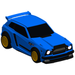

# Rocket League Fennec (NeoForge 1.21.1)

Una mod per Minecraft **NeoForge 1.21.1** che aggiunge una **Fennec di Rocket League** guidabile:
si muove, **salta** (e fa il flip), ha **100 di boost** e in basso a destra c'è il contatore del boost.



## Come si usa

1. Ottieni l'oggetto **Fennec**: scheda *Strumenti e utilità* del creativo, oppure `/give @s rlfennec:fennec`
   (ricetta in survival: 4 lingotti di ferro + colorante blu + blocco di redstone + 3 lana nera, vedi `data/rlfennec/recipe/fennec.json`).
2. Click destro su un blocco per appoggiare l'auto, poi **click destro sull'auto** per salire. **Shift** per scendere.
3. Guida:

| Tastiera | Azione |
|---|---|
| `W` / `S` | a terra: accelera / frena e retromarcia. **In aria: `W` abbassa il muso, `S` lo alza** (come spingere la leva in avanti in Rocket League) |
| `A` / `D` | a terra: sterza. In aria: **imbardata** (gira il muso a sinistra / destra) |
| `Q` / `E` | **air roll** a sinistra / destra (in aria) |
| `Alt sinistro` (tenuto) | **air roll libero**: finché lo tieni premuto `A` / `D` fanno rollare l'auto invece di girarla, come il pulsante "Air Roll" di Rocket League |
| `Spazio` | **salto**. Premilo ancora in aria (entro 1,5 s): senza direzione è un **doppio salto**, con una direzione premuta (`W` `S` `A` `D`, anche in diagonale) è un **flip** in quella direzione (vedi sotto) |
| `Ctrl sinistro` | **boost** |
| Mouse su/giù | solo la visuale. **Non punta più l'auto**: il muso si controlla con `W`/`S` |
| `Shift` | scendi (vedi sotto) |

### Cambiare i comandi

**Tastiera e mouse**: ogni azione ha il suo tasto in *Opzioni → Comandi → Tasti → Rocket League Fennec*: accelera, frena, sterza a sinistra/destra, muso giù/su, salto, boost, air roll sinistra/destra, air roll libero, scendi. Si può usare anche un tasto del mouse (sconsigliato `clic sinistro/destro`: Minecraft li usa comunque per colpire e piazzare).
* **Qualunque comando si può lasciare vuoto** ("Non assegnato"): un comando vuoto non fa niente. Se li svuoti tutti puoi anche dare all'auto tasti tutti suoi, per esempio le frecce per il muso e `WASD` per il resto.
* Mentre guidi **Furtività non fa più scendere**: si scende con il tasto "Scendi" (di default `Shift sinistro`) o con `Y` del controller. Se li lasci vuoti tutti e due, torna a valere Furtività, così non resti mai bloccato nell'auto.
* Minecraft segnala in rosso i tasti che hanno in comune con altre azioni (`W` `A` `S` `D` `Spazio` `Shift` `Q` `E` `Ctrl` sono anche movimento, "Butta oggetto", "Inventario" e "Corri"): è voluto, mentre guidi quelle azioni di Minecraft sono disattivate (non butti l'oggetto in mano e non si apre l'inventario), vale per qualsiasi tasto che condividi con un'azione dell'auto.
* In `config/rlfennec-common.toml` c'è `invertAirPitch` per invertire `W`/`S` in aria.

### Velocità di sterzata

Quattro regolatori (da 0,2 a 3,0, 1,0 è la velocità normale): sterzata a terra, beccheggio in aria, imbardata in aria e air roll. Si cambiano dal bottone **"Controller e impostazioni Fennec..."** in *Opzioni → Comandi → Tasti*, poi **"Sterzata e altre opzioni..."** (oppure *Mods → Rocket League Fennec → Config*), sezione `handling`. Sono nel file `config/rlfennec-client.toml` e valgono per te, non per gli altri giocatori.

### Flip, flip cancel e wave dash

* **Flip (dodge)**: salta, poi premi di nuovo salto **spingendo una direzione**: avanti, indietro, sinistra, destra o diagonale. L'auto fa un giro completo in quella direzione (0,75 s) e prende una spinta di velocità. Senza direzione è solo un doppio salto. Con l'air roll libero premuto non parte nessun flip.
* **Flip cancel**: durante il flip tieni premuta la direzione **opposta** (per esempio dopo un flip in avanti, indietro): la rotazione si ferma e l'auto torna com'era, ma la spinta di velocità resta. Se la annulli a metà torna in piano e non riparte.
* **Wave dash**: fai il flip poco prima di toccare terra (qualche decimo di secondo) e atterra con le ruote verso il basso: il flip viene annullato dal terreno e l'auto riparte con un impulso di velocità sopra il normale, senza usare boost. Se invece atterri sul tetto o sul muso l'auto si rimette in piedi e continua nella direzione in cui andava.
* Il flip è una rotazione vera, non un'animazione: durante il giro il boost spinge dove punta il muso in quel momento.

**Controller**: ogni azione si può mettere su qualunque tasto, levetta (in una direzione) o grilletto.
1. Apri la schermata con il bottone **"Comandi controller Fennec..."** in alto a sinistra in *Opzioni → Comandi → Tasti* (oppure *Mods → Rocket League Fennec → Config*).
2. Clicca il comando, poi premi il tasto o muovi la levetta/il grilletto che vuoi (`Esc` annulla, `Canc` toglie l'assegnazione). Ricorda che i pad PlayStation hanno `A` = Croce, `B` = Cerchio, `X` = Quadrato, `Y` = Triangolo, `LB`/`RB` = L1/R1, `LT`/`RT` = L2/R2.
3. Due comandi sullo stesso input compaiono in rosso, come per la tastiera.

Le assegnazioni sono salvate in `config/rlfennec-client.toml` (formato `"button:0"`, `"axis:5:+"`, `"none"`, descritto nel file), si possono anche modificare a mano.

Gli air roll ruotano l'auto attorno ai **suoi** assi, come in Rocket League: pitch attorno al fianco, yaw attorno al tetto, roll attorno al muso. Per questo dopo un roll di 90° `A`/`D` abbassano o alzano il muso, e il boost spinge sempre dove punta il muso, anche a testa in giù. Si può fare anche il giro della morte. Atterrando l'auto si raddrizza da sola.

| Controller | Azione |
|---|---|
| Grilletto destro / sinistro | accelera / frena e retromarcia |
| Levetta sinistra ←→ | sterza; in aria imbardata |
| Levetta sinistra ↑↓ | in aria muso giù / su (leva in avanti = muso giù) |
| `A` | salto, doppio salto e flip (con la levetta nella direzione del flip) |
| `B` | **boost** |
| `LB` / `RB` | air roll a sinistra / destra |
| `X` (tenuto) | air roll libero: la levetta sinistra ←→ fa rollare |
| `Y` | sali sulla Fennec più vicina (entro 4 blocchi) / scendi |

Il controller funziona con qualunque pad che GLFW riconosce (Xbox, PlayStation, la maggior parte dei pad USB/Bluetooth); si può usare insieme alla tastiera. **Riguarda solo l'auto**: per camminare e per i menu serve ancora tastiera e mouse (Minecraft non supporta i controller di suo; per quello esistono mod apposite).

* Il **boost** ha 100 punti e se ne vanno a 33 al secondo (100 = 3 secondi, come in Rocket League). Con il boost si supera la velocità massima (22 → 34 blocchi/s) e si spinge nella direzione del muso, anche in aria.
* Il contatore è in basso a destra: anello arancione che si svuota, numero al centro.
* Il boost si ricarica da solo dopo 2 secondi di inattività (6 punti/s). Si può cambiare o spegnere (`0` = come in Rocket League, niente ricarica) in `config/rlfennec-common.toml`.
* La camera sta dietro l'auto (la prima persona è disattivata mentre guidi): a terra segue il muso, in aria segue la direzione di marcia così i roll e i giri non la fanno girare a vuoto. Il pilota non viene disegnato.

## Compilare

Serve JDK 21.

```bash
./gradlew build
```

Il jar è in `build/libs/rlfennec-1.0.0.jar`: va copiato nella cartella `mods` di NeoForge 1.21.1 (21.1.x). Per provarla direttamente: `./gradlew runClient`.

I test della fisica (`CarPhysics`, pura matematica senza Minecraft) girano con `./gradlew test`.

## Suoni: cosa c'è e cosa no

I **suoni originali di Rocket League (motore della Fennec, boost) non sono inclusi**: sono audio di Psyonix/Epic Games, coperto da copyright, e non li ho scaricati né ricampionati. Non ho trovato nessuna fonte che li distribuisca con una licenza che permetta di metterli in una mod.

**Il motore** viene dalla registrazione che mi hai dato, tagliata in tre pezzi (`tools/prepare_engine_sound.py`): l'accensione quando sali, il loop del motore acceso mentre guidi, lo spegnimento quando scendi. Il loop è fermo al minimo quando l'auto sta ferma; sale di tono e di volume con la velocità, ha un colpo di volume quando dai gas, e quando molli scende lentamente come un motore vero.

Il resto è **sintetizzato da zero** (`tools/generate_sounds.py`): il ruggito del boost in loop, l'accensione del boost, il salto e il flip.

Se vuoi i suoni veri (per uso personale, dalla tua copia del gioco) basta **sostituire questi file** in `src/main/resources/assets/rlfennec/sounds/fennec/` e ricompilare:

| File | Quando suona |
|---|---|
| `engine_start.ogg` | una volta quando qualcuno sale |
| `engine_loop.ogg` | in loop mentre qualcuno guida; l'altezza va da 0,5× a 2× con la velocità |
| `engine_stop.ogg` | una volta quando il pilota scende |
| `boost_loop.ogg` | in loop finché tieni premuto il boost |
| `boost_start.ogg` | una volta all'accensione del boost |
| `jump.ogg`, `flip.ogg` | salto e flip |

Devono essere **OGG Vorbis mono**; i due loop devono chiudersi senza click:

```bash
ffmpeg -i mio_motore.wav -ac 1 -ar 44100 -c:a libvorbis -q:a 4 engine_loop.ogg
```

## Il modello 3D

Il modello è quello del file che mi hai dato (`fennec_-_rocket_league_car.obj`, 58 851 vertici / 84 823 triangoli, texture incluse). `tools/convert_fennec_model.py` lo converte in `assets/rlfennec/models/entity/fennec.bin`: scala 0,025 (l'auto è lunga 3,5 blocchi), le quattro ruote sono parti separate così girano e sterzano. Viene caricato una sola volta nella GPU e disegnato con lo shader delle entità di Minecraft con texture trilineari, quindi costa poco anche con tante auto.

```bash
python3 tools/convert_fennec_model.py percorso/fennec_-_rocket_league_car.obj
python3 tools/render_icon.py      # rigenera l'icona dell'oggetto
```

> Il modello e le texture della Fennec sono proprietà di Psyonix/Epic Games. Il codice di questa mod è libero (MIT), ma gli asset del modello non lo sono: tienili per uso personale e non ridistribuire il jar.

## Come funziona la rete (multiplayer)

Come per le barche, l'auto è simulata dal client di chi guida (sterzo senza ritardo) e Minecraft sincronizza la posizione. Un piccolo pacchetto (`CarControlPayload`) comunica al server il boost rimasto, se il boost è acceso e i salti, così gli altri giocatori vedono fiamme, flip e sentono i suoni. Di conseguenza il boost è "fidato" dal client: va bene tra amici, non è a prova di cheat.

## Cosa non c'è (ancora)

* Pad del boost sul terreno (ora il boost si ricarica da solo, vedi sopra).
* Palla e porte. È solo l'auto.
* Non è stato provato su un server dedicato né con due giocatori.
* Il controller è provato solo a livello di logica (la mappatura ha i test, la lettura di GLFW non dà errori senza pad collegato) ma non con un pad fisico. La tastiera è stata provata con veri eventi di tasto in un client Minecraft reale.
